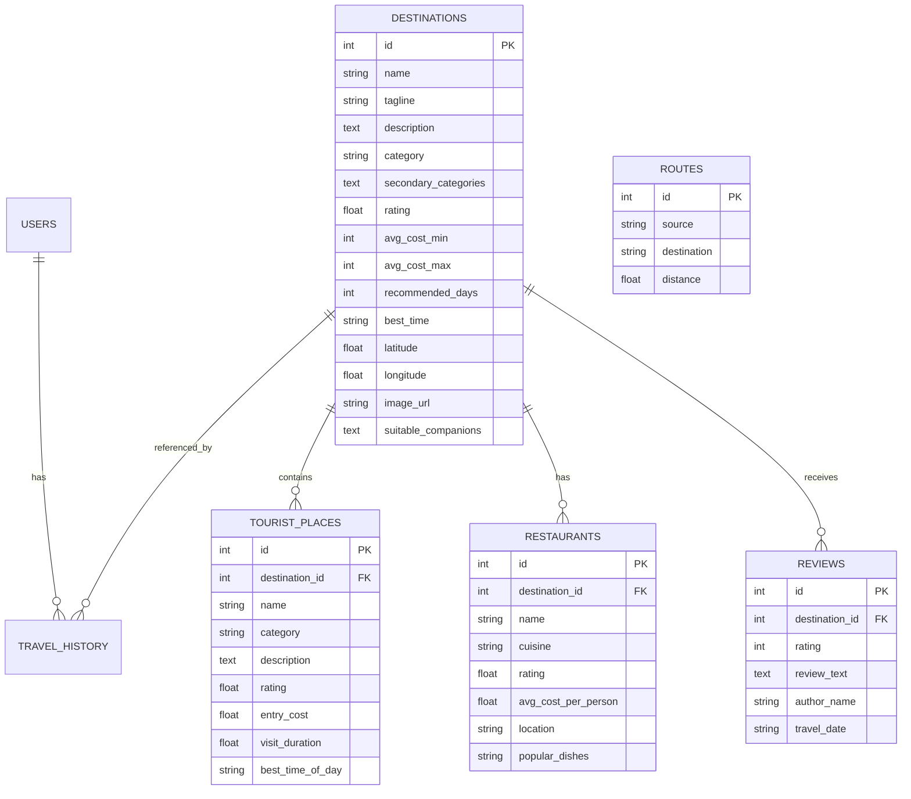

# Travel Planner using Graph & Dijkstra's Algorithm

> **A Comprehensive Full-Stack Academic Web Application (BCA / B.Tech Data Structures & Algorithms Project)**  
> Developed with **Python 3, Flask, SQLite, and Vanilla JavaScript/CSS** (No paid APIs or complex frontend frameworks).

---

## 1. Problem Statement

Planning a multi-city travel trip requires solving two interconnected challenges:
1. **Decision Making (Where to go?)**: Travelers often struggle to choose a destination that balances their personal interests, budget constraints, travel duration, companion preferences, and prior travel history.
2. **Optimal Route Planning (How to reach there efficiently?)**: Once a destination is selected, travelers need to find the shortest and most cost-effective road route from their origin through interconnected highways and transit hubs.

Most commercial travel websites act as either plain booking platforms or static blogs. This project unifies **multi-criteria decision recommendations**, **graph theory**, **Dijkstra's shortest path algorithm**, **dynamic budget estimation**, and **dynamic day-wise itinerary scheduling** into a single, cohesive, and demonstrative web application.

---

## 2. Project Objectives

- **Implement Graph Data Structures**: Represent real-world cities and road highways as an undirected weighted graph using an **Adjacency List** representation.
- **Implement Dijkstra's Algorithm from Scratch**: Calculate the shortest path and road distance between any two locations using a manual priority queue (min-heap via standard library `heapq`), without using external shortest-path libraries (such as NetworkX).
- **Provide Algorithmic Explainability for Project Viva**: Track and display step-by-step edge relaxation diagnostics (showing tentative distance updates) for academic defense.
- **Content-Based Recommendation Engine**: Compute personalized destination recommendations with transparent "Why this was recommended" explanations.
- **Dynamic Cost & Itinerary Modules**: Provide real-time interactive budget calculations and automated day-by-day scheduling driven by database records.
- **Zero Paid Dependencies**: Operate completely offline or with free OpenStreetMap tiles via Leaflet.js.

---

## 3. Key Features

| Feature | Description |
| :--- | :--- |
| **1. Modern Travel Landing Page** | Clean, responsive UI with project statistics, hero section, featured destination cards, and quick navigation. |
| **2. User Travel Profiling** | Multi-criteria questionnaire capturing visited cities, interests, budget tier, duration, companions, and transport mode. |
| **3. Travel History Tracking** | Session and database tracking of visited cities to eliminate redundant recommendations and reward exploration of adjacent gateway hubs. |
| **4. Recommendation Engine** | Transparent content-based scoring ($0 - 100\%$) with human-readable "Why recommended" justification bullets. |
| **5. Weighted Graph** | Adjacency list representation storing cities ($|V|$) and bidirectional road edges ($|E|$) with highway distances. |
| **6. Dijkstra's Shortest Path** | Manual min-heap implementation calculating optimal path, total distance, segment distances, and relaxation execution trace. |
| **7. Destination Details** | Rich destination profiles with photo galleries, taglines, ratings, best seasons, and recommended duration. |
| **8. Tourist Places** | Database-driven attractions with entry costs, estimated visit duration, categories, and optimal time of day. |
| **9. Local Dining & Eateries** | Recommended restaurants, cuisines, average cost per person, and famous signature dishes. |
| **10. Traveler Reviews** | Seeded sample project reviews with star ratings, reviewer names, and feedback. |
| **11. Dynamic Budget Calculator** | Interactive sliders and inputs updating transportation, accommodation, food, sightseeing, and buffer costs in real time. |
| **12. Day-Wise Itinerary** | Dynamic schedule synthesizing morning, afternoon, and evening slots paired with local restaurant recommendations. |
| **13. Route & Destination Integration** | Seamless transition from route calculation directly to destination guide, budget estimator, and itinerary. |
| **14. Leaflet Map Visualization** | Free OpenStreetMap integration displaying route polyline, origin marker (green), destination marker (red), and transit nodes (blue). |

---

## 4. Technology Stack

- **Backend**: Python 3.9+, Flask 3.1, Flask-SQLAlchemy 3.1, Werkzeug
- **Algorithm Engine**: Pure Python standard library (`heapq`, `collections.defaultdict`, `math`)
- **Database**: SQLite 3 (Auto-created and auto-seeded on first run)
- **Frontend**: Semantic HTML5, Modern CSS3 (Flexbox/Grid, CSS Variables), Vanilla ES6 JavaScript
- **Map Rendering**: Leaflet.js 1.9.4 + OpenStreetMap Tiles (100% Free, No API keys required)
- **Icons & Typography**: FontAwesome 6, Google Fonts (*Plus Jakarta Sans*)
- **Testing**: `pytest` 8.4+

---

## 5. System Architecture

```
Travel-Planner/
│
├── app.py                     # Flask application factory, routes registration & startup auto-seed
├── config.py                  # Database paths, secret keys, and application configurations
├── requirements.txt           # Project dependencies (Flask, Flask-SQLAlchemy, pytest)
├── README.md                  # Comprehensive academic & viva documentation
│
├── database/                  # Database Layer
│   ├── __init__.py            # SQLAlchemy db instance
│   ├── models.py              # User, Destination, TravelHistory, RouteEdge, TouristPlace, Restaurant, Review
│   ├── database.py            # Initialization and helper queries
│   └── seed.py                # Automatic seed loader from seed_data.json
│
├── data/
│   └── seed_data.json         # 15 Indian destinations, 29 bidirectional highways, 45+ places, 40+ restaurants
│
├── graph/                     # Data Structures & Algorithms Core (Academic Focus)
│   ├── __init__.py            # Graph module exports
│   ├── graph.py               # WeightedGraph class with Adjacency List representation
│   └── dijkstra.py            # Manual Dijkstra algorithm with min-heap priority queue & relaxation trace
│
├── recommendation/            # Content-Based Recommendation Layer
│   ├── __init__.py
│   └── recommender.py         # Multi-factor scoring engine with explainability generator
│
├── services/                  # Business Logic Services
│   ├── __init__.py
│   ├── route_service.py       # Bridges DB edges, WeightedGraph, Dijkstra, and Leaflet coordinates
│   ├── budget_service.py      # Dynamic cost formulas and accommodation/transport multipliers
│   └── itinerary_service.py   # Dynamic multi-day scheduler using destination attractions & dining
│
├── routes/                    # Modular Flask Blueprints
│   ├── __init__.py
│   ├── main_routes.py         # Home (/), Explore (/destinations), Detail (/destination/<id>), Route (/route)
│   ├── auth_routes.py         # Sign in, register, guest access (/guest), logout
│   ├── plan_routes.py         # Questionnaire (/plan), Recommendations (/recommendations), Profile (/profile)
│   └── api_routes.py          # JSON APIs (/api/route, /api/calculate-budget, /api/generate-itinerary)
│
├── templates/                 # Jinja2 Frontend Templates (Also mirrored at frontend/templates)
│   ├── base.html              # Layout, navbar, flash messages, footer, Leaflet scripts
│   ├── index.html             # Landing page with stats and live Dijkstra demo box
│   ├── login.html             # Login form with one-click Guest entry
│   ├── register.html          # Account registration
│   ├── plan.html              # Travel questionnaire with visited chips & criteria selectors
│   ├── recommendations.html   # Ranked recommendation cards with "Why recommended" breakdown
│   ├── destinations.html      # Catalog of 15 destinations with search and category filters
│   ├── destination.html       # Destination guide with attractions, dining, reviews, budget & itinerary tabs
│   ├── route.html             # Route planner with Leaflet map, segment table, and viva relaxation trace
│   ├── itinerary.html         # Day-wise itinerary view with print capability
│   ├── profile.html           # User travel history & preference summary
│   ├── 404.html               # Custom 404 error page
│   └── 500.html               # Custom 500 error page
│
├── static/                    # Frontend Assets (Also mirrored at frontend/static)
│   ├── css/
│   │   └── style.css          # Modern, responsive styles, cards, badges, and print media queries
│   └── js/
│       ├── main.js            # Menu toggling, active states, auto-dismissing alerts
│       ├── route.js           # Leaflet map rendering, waypoint pins, polyline, and trace toggle
│       └── budget.js          # Interactive live budget calculation via AJAX fetch
│
├── frontend/                  # Symlinked/aliased frontend directory for modular clarity
├── backend/                   # Symlinked/aliased backend directory for modular clarity
│
└── tests/                     # Automated Test Suite (28 unit & integration tests)
    ├── __init__.py
    ├── test_graph.py          # Adjacency list, edge insertion, and case-insensitivity tests
    ├── test_dijkstra.py       # Known road routes, edge cases, disconnected graphs, relaxation trace
    ├── test_recommendation.py # Interest matching, budget scoring, history deduplication
    ├── test_budget.py         # Transport mode formulas and accommodation tier multipliers
    ├── test_itinerary.py      # Day-wise attraction distribution
    ├── test_routes.py         # Flask HTTP routes, forms, and JSON API endpoints
    └── test_e2e_flow.py       # Full primary user journey verification
```

---

## 6. Graph Representation (Academic & Viva Focus)

In this project, the road network is modeled as a **Weighted Undirected Graph** $G = (V, E, W)$:
- **Vertices ($V$)**: Represent cities or destinations (e.g., Delhi, Dehradun, Mussoorie, Dhanaulti, etc.).
- **Edges ($E$)**: Represent bidirectional highways connecting two cities.
- **Weights ($W$)**: Represent the physical road distance between cities in kilometers ($km$).

### Why Adjacency List instead of Adjacency Matrix?
1. **Space Efficiency**: Road networks are inherently sparse graphs where the degree of any city is small ($deg(v) \ll |V|$). An adjacency list consumes $O(|V| + |E|)$ memory, whereas an adjacency matrix requires $O(|V|^2)$, wasting memory on non-existent road connections.
2. **Neighbor Traversal**: In Dijkstra's algorithm, exploring the neighbors of vertex $u$ takes $O(deg(u))$ time with an adjacency list, compared to scanning all $|V|$ columns in an adjacency matrix.

### Adjacency List Structure (`graph/graph.py`):
```python
self.adjacency_list = {
    "Dehradun": [("Mussoorie", 35.0), ("Rishikesh", 45.0), ("Haridwar", 52.0), ("Chandigarh", 170.0), ("Chopta", 210.0)],
    "Mussoorie": [("Dehradun", 35.0), ("Dhanaulti", 60.0), ("Shimla", 260.0)],
    "Dhanaulti": [("Mussoorie", 60.0), ("Rishikesh", 75.0)],
    ...
}
```

---

## 7. Dijkstra's Algorithm Implementation

Implemented manually in [`graph/dijkstra.py`](graph/dijkstra.py).

### How It Works:
1. **Initialization**: Initialize `distances[v] = ∞` for all vertices $v \in V$, and `distances[start] = 0`. Set `previous_nodes[v] = None`.
2. **Priority Queue (Min-Heap)**: Push `(0.0, start_vertex)` into the min-heap.
3. **Extraction & Greedy Selection**: Pop the vertex $u$ with the minimum tentative distance from the heap. If $u$ is already visited, continue. Mark $u$ as visited.
4. **Edge Relaxation**: For each neighbor $v$ of $u$ with road weight $w(u, v)$:
   $$\text{tentative\_distance} = \text{dist}[u] + w(u, v)$$
   If $\text{tentative\_distance} < \text{dist}[v]$:
   - $\text{dist}[v] \leftarrow \text{tentative\_distance}$
   - $\text{previous\_nodes}[v] \leftarrow u$
   - Push `(tentative_distance, v)` into the priority queue.
5. **Path Reconstruction**: Backtrack from `end_vertex` to `start_vertex` using `previous_nodes` to yield the ordered route sequence.

### Complexity Analysis for Viva:
- **Time Complexity**:
  - Extract-Min operation: Called at most $|V|$ times $\rightarrow O(|V| \log |V|)$
  - Edge Relaxation (Heap push): Executed at most $|E|$ times $\rightarrow O(|E| \log |V|)$
  - **Total Time Complexity**: $\mathcal{O}((|V| + |E|) \log |V|)$
- **Space Complexity**:
  - Distance map: $O(|V|)$
  - Predecessor map: $O(|V|)$
  - Priority Queue: $O(|E|)$
  - **Total Space Complexity**: $\mathcal{O}(|V| + |E|)$

---

## 8. Recommendation Engine Logic

Implemented in [`recommendation/recommender.py`](recommendation/recommender.py).

The recommendation engine uses a transparent, content-based multi-criteria scoring function normalized between $0\%$ and $100\%$:

$$\text{Final Score} = S_{\text{interests}} + S_{\text{budget}} + S_{\text{duration}} + S_{\text{distance}} + S_{\text{companion}} + S_{\text{history}} + S_{\text{rating}}$$

### Weight Distribution:
1. **Interest Match (30 pts)**: Compares user travel types (Mountains, Nature, Adventure, Historical, etc.) against destination primary and secondary tags.
2. **Budget Match (25 pts)**: Evaluates overlap between destination average trip cost $[\text{min}, \text{max}]$ and user budget tier.
3. **Duration Match (15 pts)**: Penalizes discrepancy between user planned days and destination recommended days.
4. **Distance & Proximity (10 pts)**: Rewards destinations within user's preferred radius ($<100\text{ km}$ or $<300\text{ km}$) calculated from the graph.
5. **Companion Compatibility (10 pts)**: Verifies destination suitability for Solo, Friends, Family, or Couple travel.
6. **Travel History Relevance (10 pts)**:
   - Visited cities receive low priority ($2\text{ pts}$) so users discover new places.
   - Unvisited cities adjacent to previously visited cities receive an **Exploration Bonus** ($10\text{ pts}$).
7. **Rating Quality Bonus (Up to 5 pts)**: Quality bump based on traveler rating.

---

## 9. Database Design (SQLite)

The application uses an SQLite database with 7 relational tables:



---

## 10. Complete Application Workflow

```
[User Arrives on Home Page]
            ↓
[Click "Plan My Trip" or "Continue as Guest"]
            ↓
[Fill Travel Questionnaire]
- Select Previously Visited Cities (e.g., Dehradun)
- Select Interests (e.g., Mountains, Nature)
- Select Budget Tier (e.g., ₹5,000 - ₹10,000)
- Select Duration (e.g., 2 - 3 Days) & Companions (Friends)
            ↓
[Recommendation Engine Ranks Destinations]
- Mussoorie (96% Match, Why: Matches Nature & Mountains, Adjacent to visited Dehradun)
- Dhanaulti (94% Match)
- Chopta (91% Match)
            ↓
[User Selects Destination: Mussoorie]
- View Tourist Attractions (Kempty Falls, Gun Hill)
- View Recommended Dining (Cafe By The Way, Char Dukan)
- View Traveler Reviews
            ↓
[Dynamic Budget Calculation]
- Adjust travelers, hotel tier, food tier -> Updates Total (₹) live
            ↓
[Dynamic Day-Wise Itinerary]
- Synthesizes morning/afternoon/evening slots and meals from database
            ↓
[User Selects Origin City: Dehradun]
            ↓
[Graph + Dijkstra Computes Optimal Route]
- Output: Dehradun → Mussoorie (35.0 km)
- Displays Route on Leaflet Map with Waypoint Pins
- Displays Step-by-Step Relaxation Trace for Viva
```

---

## 11. Installation Guide

### Prerequisites:
- Python 3.9 or higher
- `pip` (Python package manager)

### Step 1: Clone or Navigate to the Project Directory
```bash
cd /Users/shambhavisingh/Desktop/Fit2Lit---Fitness-that-fits-you
```

### Step 2: Create and Activate Virtual Environment
```bash
python3 -m venv venv
source venv/bin/activate
```

### Step 3: Install Required Dependencies
```bash
pip install -r requirements.txt
```

---

## 12. How to Run & Viva Demonstration Script

### Running the Web Server:
```bash
python3 app.py
```
The application will automatically:
1. Create `database/travel_planner.db` SQLite database if it does not exist.
2. Seed the 15 Indian destinations, 58 route highway edges, attractions, restaurants, and reviews from `data/seed_data.json`.
3. Start the local server at **`http://127.0.0.1:5001`**.

Open your browser and navigate to:
```
http://127.0.0.1:5001
```

### Script for Viva / Academic Demonstration:
1. **Explain Problem Statement & Architecture**:
   - Open `http://127.0.0.1:5001` to show the landing page and the live stats counter.
2. **Demonstrate Questionnaire & Recommendation Scoring**:
   - Click **"Plan My Trip"** or navigate to `/plan`.
   - Select visited city: `Dehradun`.
   - Select interests: `Mountains` and `Nature`.
   - Select budget: `₹5,000 - ₹10,000`, Duration: `2 - 3 Days`.
   - Click **"Generate Recommendations"**.
   - Show the examiner the **Match Percentage** and the **"Why Recommended for You"** explanation box justifying the pick.
3. **Demonstrate Destination Details, Budget & Itinerary**:
   - Click **"View Destination Details"** on Mussoorie.
   - Show attractions (Kempty Falls, Gun Hill) and restaurants (Cafe By The Way).
   - Adjust the **Budget Calculator** travelers and hotel tier sliders to demonstrate real-time dynamic total calculation.
   - Scroll to the **Day-Wise Itinerary** showing morning/afternoon/night slots.
4. **Demonstrate Dijkstra Shortest Path & Adjacency List**:
   - Navigate to `/route?source=Dehradun&destination=Dhanaulti`.
   - Show the result: `Dehradun → Mussoorie → Dhanaulti = 95.0 km`.
   - Point out the **Leaflet OpenStreetMap** showing the route polyline and waypoint markers.
   - Click **"Show Dijkstra Execution Trace (Viva Examiner View)"** to reveal the complete relaxation steps table showing how tentative distances are updated during priority queue extraction.

---

## 13. Automated Testing

The project includes 28 automated unit and integration tests covering Dijkstra, WeightedGraph, Recommendation scoring, Budget formulas, Itinerary scheduling, and Flask HTTP endpoints.

### Run All Tests:
```bash
pytest -v tests/
```

### Test Coverage Summary:
- `tests/test_graph.py`: Adjacency list creation, vertex addition, bidirectional edge management, case-insensitivity.
- `tests/test_dijkstra.py`: Known path calculations (Dehradun to Dhanaulti = 95km, Delhi to Mussoorie = 285km), diamond graphs, same origin/destination, unknown vertices, disconnected graphs, relaxation trace recording.
- `tests/test_recommendation.py`: Interest matching, budget compatibility, travel history deduplication, adjacent hub bonus.
- `tests/test_budget.py`: Cost formulas, vehicle vs. person transport rates, accommodation tiers.
- `tests/test_itinerary.py`: Day length scheduling, attraction period segregation.
- `tests/test_routes.py`: Flask views, form submissions, session handling, 404 handler, JSON REST APIs.
- `tests/test_e2e_flow.py`: Full primary user journey from guest entry to route generation.

---

## 14. Future Scope

The application is architected modularly, allowing easy extensions for real-world production deployment:
1. **Live Traffic Integration**: Dynamically alter edge weights in the graph using live traffic congestion indices.
2. **Weather API**: Incorporate real-time mountain weather forecasts and monsoon warning alerts.
3. **Multi-Modal Transit Graph**: Expand edge types to model flight connections, express trains, and local buses on a layered graph.
4. **Collaborative Planning**: Allow multiple users to vote on destinations and build group itineraries simultaneously.
5. **Real-Time GPS Geolocation**: Automatically detect user departure coordinates to find the nearest highway entry node.
